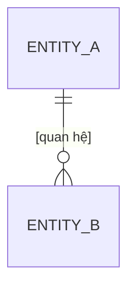

# Domain model — [Tên app]

<!--
Các entity, thuộc tính chính và quan hệ, ở mức KHÁI NIỆM (không phải schema DB, không chọn kiểu dữ liệu cụ thể).
Schema thật do plan.md của từng change quyết định.
- Mỗi entity thuộc đúng một domain (xem bảng mã domain trong .claude/CLAUDE.md).
- Entity có vòng đời → trỏ tới capabilities/<domain>/states.md.
- Chưa rõ → [NEEDS CLARIFICATION].
-->

## Tổng quan

## [Entity A] — domain [domain]

[1–2 câu: entity này là gì.]

| Thuộc tính | Ý nghĩa | Bắt buộc | Ràng buộc |
| --- | --- | --- | --- |
| [tiêu đề] | [...] | có | [độ dài, duy nhất, khoảng giá trị — lấy từ tài liệu] |

- **Quan hệ:** [Entity A] có nhiều [Entity B]; [...]
- **Vòng đời:** xem `capabilities/[domain]/states.md`
- **Ai sở hữu:** [...]

## Câu hỏi còn mở

- [NEEDS CLARIFICATION: …]
