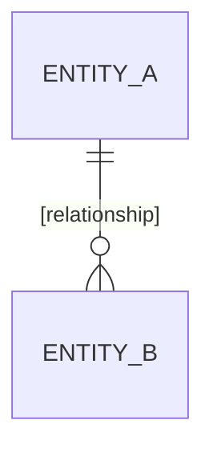

# Domain model — [App name]

<!--
Entities, main attributes and relationships at CONCEPT level (not a DB schema, no concrete data types).
The real schema is decided by each change's plan.md.
- Each entity belongs to exactly one domain (see the domain code table in .claude/CLAUDE.md).
- Entity with a lifecycle → point to capabilities/<domain>/states.md.
- Unclear → [NEEDS CLARIFICATION].
-->

## Overview

## [Entity A] — domain [domain]

[1–2 sentences: what this entity is.]

| Attribute | Meaning | Required | Constraints |
| --- | --- | --- | --- |
| [title] | [...] | yes | [length, unique, value range — taken from the documents] |

- **Relationships:** [Entity A] has many [Entity B]; [...]
- **Lifecycle:** see `capabilities/[domain]/states.md`
- **Owned by:** [...]

## Open questions

- [NEEDS CLARIFICATION: …]
