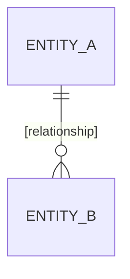

# Domain model — [App name]

<!--
Entities, main attributes and relationships at CONCEPT level (not a DB schema, no concrete data types).
The real schema is decided by each change's plan.md.
- Each entity belongs to exactly one domain (see the domain code table in .claude/CLAUDE.md).
- Entity with a lifecycle → point to capabilities/<domain>/states.md.
- Each domain has ONE "Features" table: the long-lived areas of behavior of the domain. Each row is a folder
  specs/capabilities/<domain>/<feature>/ holding that feature's spec.md. Feature names are English kebab-case.
  /spec-bootstrap fills the table; /speckit-specify adds a row when a change introduces a new feature.
  scripts (change.py, spec_check.py) read it: keep the heading "## Features — domain <domain>" and the two columns.
- Unclear → [NEEDS CLARIFICATION].
-->

## Overview

## Features — domain [domain]

| Feature | Scope |
| --- | --- |
| [feature-name] | [one line: which behaviors of the domain live in this feature] |

## [Entity A] — domain [domain]

[1–2 sentences: what this entity is.]

| Attribute | Meaning | Required | Constraints |
| --- | --- | --- | --- |
| [title] | [...] | yes | [length, unique, value range — taken from the documents] |

- **Relationships:** [Entity A] has many [Entity B]; [...]
- **Lifecycle:** see `capabilities/[domain]/states.md`
- **Owned by:** [...]

## Open questions

- [NEEDS CLARIFICATION: …]
