# AI-native SDLC harness

A skeleton (harness) for building software with Claude Code the **Spec-Driven Development** way: from requirement documents
to spec, plan, tasks, then agents write the tests and the code, checked by CI and hidden tests.

- An app built on this skeleton is a pnpm monorepo: `frontend/` (Next.js 16, React 19, TanStack Query, Tailwind) and `backend/`
  (NestJS, TypeORM, PostgreSQL, Redis). Tests use Vitest.
- Detailed rules: [`CLAUDE.md`](CLAUDE.md) (CODE / TEST harness) and [`.claude/CLAUDE.md`](.claude/CLAUDE.md) (SPEC harness).
- Agents running in a pod: [`k8s/agents/README.md`](k8s/agents/README.md).

## Workflow overview

The **orange boxes with 🧑** are where **a person is needed** (human in the loop): the person does it, answers questions or approves. The other
boxes are run by Claude or the agents on their own. Details of each point: section [Human in the loop](#human-in-the-loop).

```mermaid
flowchart TD
    subgraph S0["0 - Setup (once)"]
        A1["🧑 Set up the machine: pnpm, Python 3.9+ with PyYAML, Docker"] --> A2["🧑 Add the BA / customer documents<br/>to docs/requirements/ (in English)"]
        A2 --> A3["🧑 type /spec-bootstrap<br/>Claude builds specs/_system/ + specs/capabilities/<br/>+ the roadmap of changes"]
        A3 --> A4{"🧑 Approve roadmap.md<br/>+ answer the questions?"}
        A4 -- "not yet" --> A2
    end

    A4 -- "approved" --> B1

    subgraph S1["1 - SPEC (each change in the roadmap)"]
        B1["/speckit-specify<br/>creates branch NNN-name + spec.md (delta)"] --> B2["🧑 /speckit-clarify<br/>you answer at most 5 questions"]
        B2 --> B3["/spec-edge-cases<br/>adds scenario IDs, P1-P3, Recovery"]
        B3 --> B4{"🧑 Approve the spec?"}
        B4 -- "not yet" --> B2
    end

    B4 -- "approved: status approved" --> C1

    subgraph S2["2 - PLAN"]
        C1["/speckit-plan<br/>plan.md + ADRs + Data Model"] --> C2["/speckit-checklist<br/>checklists/quality.md"]
        C2 --> C3["/speckit-tasks<br/>tasks.md, each task lists its Scenarios"]
        C3 --> C4["/speckit-analyze<br/>checks that spec / plan / tasks agree"]
        C4 --> C5{"You approve plan + tasks?"}
        C5 -- "not yet" --> C1
    end

    C5 -- "approved" --> D1["3 - HANDOFF<br/>approval.py verify + spec_check --stage spec<br/>commit the change folder (no PR yet)"]

    D1 --> H1["🧑 Write hidden tests<br/>claude --agent private-test-writer<br/>(own session, reads the spec only)"]
    H1 --> D2{"🧑 Confirm the task list<br/>before dispatching?"}
    D2 -- "agreed" --> E1

    subgraph S4["4 - CODE + TEST (pod or local subagents)"]
        E1["PLAN: code-planner + test-planner"] --> E2["RED: test-writer<br/>new tests must FAIL"]
        E2 --> E3["GREEN: code-writer<br/>pnpm ci:local passes"]
        E3 --> E4["REVIEW: mutation score<br/>+ code-reviewer + test-critic<br/>+ security-reviewer"]
        E4 -- "tests need fixing" --> E2
        E4 -- "code needs fixing" --> E3
        E4 -- "passed" --> E5["Open the PR<br/>(pod: collect.sh pushes from the host)"]
    end

    E5 --> F1

    subgraph S5["5 - INDEPENDENT CHECKS"]
        F1["Hidden tests test/private<br/>(run on the local machine)"] --> F2["CI GitHub Actions<br/>jobs ci + spec-check + red-check"]
    end

    F1 -- "FAIL / SKIPPED" --> X1["🧑 You decide<br/>(agents may not see the hidden tests)"]
    F2 -- "FAIL: re-dispatch a fix task with the log" --> E1
    F2 -- "TIMEOUT / review not passed" --> X1
    E1 -. "SPEC_PROBLEM" .-> B2
    F2 -- "PASS" --> G1

    subgraph S6["6 - CLOSING THE CHANGE"]
        G1["spec_check --stage archive"] --> G2["🧑 type /spec-archive NNN-name<br/>confirm the merge plan"]
        G2 --> G3["🧑 Review + merge the PR into harness-base<br/>(Claude does not merge)"]
    end

    G3 -- "next change" --> B1

    classDef human fill:#ffe0b2,stroke:#e65100,stroke-width:2px,color:#000
    class A1,A2,A3,A4,B2,B4,C5,H1,D2,X1,G2,G3 human
```



## Human in the loop

At the points below, Claude **stops and waits for a person**, or the job can only be done by a person. Apart from these points, Claude and the agents run on their own.

| # | When | What the person does | Why it must be a person |
| --- | --- | --- | --- |
| 1 | Setup | Set up the machine; create the secret and the cluster if pods are used | Needs tokens and rights on the machine |
| 2 | Setup | Put the BA / customer documents into `docs/requirements/` (translated to English) | Requirements come from people |
| 3 | Bootstrap | **Type** `/spec-bootstrap` **yourself** | The command has `disable-model-invocation`; Claude cannot call it |
| 4 | Bootstrap | ✋ Approve `specs/_system/roadmap.md` and answer the questions Claude raises | The order and scope of the changes are business decisions |
| 5 | Spec | Answer the questions of `/speckit-clarify` (at most 5) | The command runs only in the main session because it needs a person to answer |
| 6 | Spec | Answer the `[NEEDS CLARIFICATION]` points | Claude may not set numbers, limits, permissions or data-deletion policies itself |
| 7 | Spec | ✋ **Approve the spec**: run `python3 .specify/scripts/approval.py approve --change <change> --gate spec` yourself in your terminal (the command writes the hash into `approval.json` and sets `status: approved`) | `/speckit-plan` refuses to run while the spec is not approved; Claude cannot run the approval command |
| 8 | Plan | ✋ **Approve plan + tasks**: run `python3 .specify/scripts/approval.py approve --change <change> --gate plan` yourself in your terminal | This is the last gate before agents write code |
| 9 | Plan | Agree if the plan wants to change the stack | The stack changes only with the user's permission |
| 10 | Before code | Write hidden tests in a separate session: `claude --agent private-test-writer` | The agents that write code and tests must never see the hidden tests |
| 11 | Before code | Confirm the task list before running `dispatch.sh` | Every run uses quota and opens a real PR |
| 12 | Checks | Decide on `PRIVATE: FAIL` / `SKIPPED`, `CHECKS: TIMEOUT` or a review that did not pass (draft PR) | Claude does not re-dispatch by itself and does not reveal hidden test content to agents |
| 13 | Any time | Handle a `SPEC_PROBLEM` (an agent reports the spec wrong or incomplete) by running clarify again | No agent may edit `specs/` |
| 14 | Closing the change | **Type** `/spec-archive NNN-name` **yourself**, confirm the merge plan and decide if tasks are still open | Once merged into the living spec there is no way back |
| 15 | Closing the change | ✋ Review and **merge** the PR into `harness-base` | Claude never merges PRs |
| 16 | Any time | Allow `git push` | Claude pushes only when asked; pods never push: `collect.sh` on this machine pushes their `agent/*` branch and opens the PR |
| 17 | Any time | Allow edits to harness files (`.claude/`, `CLAUDE.md`, `package.json`, `.github/`, `ci/`, `k8s/`) | These change the rules of the harness itself |
| 18 | Bug fix | ✋ **Approve the root cause**: run `python3 .specify/scripts/approval.py approve --bug <id> --gate root-cause --summary "<one line>"` yourself in your terminal | No fix before the user approves a root cause; the approval also locks the reproduction test |
| 19 | Plan approved | When the change MODIFIES / REMOVES requirements: run `python3 .specify/scripts/private_tests.py stale\|quarantine\|restore --change <change>` yourself, then write new hidden tests | Only the user handles hidden tests; agents cannot run this script |

## Step by step

### 0. Setup (once)

1. **Set up the machine**
   - `pnpm`, Node, Docker (for `pnpm db:up`).
   - Python 3.9+ with PyYAML: `python3 -m pip install --user pyyaml` (without it the `/speckit-*` commands fail).
   - For UI tests: create `.venv` (the scripts run with `.venv/bin/python`).
   - For agents in a pod: follow section "One-time setup" in [`k8s/agents/README.md`](k8s/agents/README.md)
     (kind cluster, secret `agent-secrets`, ConfigMap `mwg-ca`).
2. **Add the BA or customer documents to `docs/requirements/`** (create the folder if it does not exist).
   The documents are written in English; translate a Vietnamese version first.
3. **Run `/spec-bootstrap`** (you type it; Claude does not call this command itself). Claude reads the documents and the existing code, then builds:
   - `specs/_system/`: `glossary.md`, `domain-model.md` (with a Features table per domain), `nfr.md`, `roadmap.md`,
     `traceability.md`.
   - `specs/capabilities/<domain>/<feature>/spec.md`: the living spec, describing what the system does **now**.
   - The table of domain codes (`ABC`, …) in `.claude/CLAUDE.md`.

   Review `specs/_system/roadmap.md`: it is the list of changes (`001-...`, `002-...`) to work through one by one.

### 1. Write the spec of a change

| Step | Command | Result |
| --- | --- | --- |
| 1 | `/speckit-specify` | Branch `NNN-<name>`, file `specs/changes/NNN-<name>/spec.md` (delta: `ADDED` / `MODIFIED` / `REMOVED` / `RENAMED` / `MOVED`) |
| 2 | `/speckit-clarify` | Claude asks you at most 5 questions and writes the answers into the spec. **Run it in the main session** |
| 3 | `/spec-edge-cases` | Scenarios with IDs (`ABC-003-S2`), Given / When / Then, P1–P3, `→ Recovery:`; file `checklists/edge-cases.md` |
| 4 | ✋ **Approve the spec** | You read the spec. If you agree, run `python3 .specify/scripts/approval.py approve --change <change> --gate spec` yourself in your terminal (writes the hash into `approval.json`, sets `status: approved`) |

Unclear points are written `[NEEDS CLARIFICATION: ...]`: Claude does not invent numbers, limits or permissions.

### 2. Plan and tasks

| Step | Command | Result |
| --- | --- | --- |
| 5 | `/speckit-plan` | `plan.md` (with the mandatory `## Test Strategy`, `## Quickstart`), adds `## Architecture Decisions` and `## Data Model` to `spec.md` |
| 6 | `/speckit-checklist` | `checklists/quality.md`; every decision added to the spec must come with a scenario |
| 7 | `/speckit-tasks` | `tasks.md`: no test tasks, each task lists `Scenarios: <ID,…>` |
| 8 | `/speckit-analyze` | Reports where spec / plan / tasks disagree; CRITICAL issues are fixed in plan / tasks |
| 9 | ✋ **Approve plan + tasks** | You run `python3 .specify/scripts/approval.py approve --change <change> --gate plan` in your terminal (hashes `spec.md` + `plan.md` + `tasks.md`; refused while the spec approval is missing or no longer matches) |

Approvals are locked by hash (`approval.json` + `.approved/`, written only by `approval.py approve` in your terminal). Before any
writer works on the change, `python3 .specify/scripts/approval.py verify --change <change>` must pass (the pod runs it too); a change
to `spec.md`, `plan.md` or `tasks.md` after the approval needs a new approval.

**Stale hidden tests**: when the change MODIFIES / REMOVES requirements, `approve --gate plan` prints how many hidden test files
are affected. In your own terminal run `python3 .specify/scripts/private_tests.py stale --change <change>`, then
`quarantine --change <change> --kind removed|modified|all` (moves them to `<package>/test/private/_stale/<change>/`, never deletes;
`restore` moves them back), then write new hidden tests for the ADDED / MODIFIED requirements with `claude --agent private-test-writer`.

Steps 1, 3 can be given to the agent `spec-writer` and steps 5–8 to the agent `planner`.

### 3. Handoff

```bash
python3 .specify/scripts/approval.py verify --change NNN-<name>
python3 .specify/scripts/spec_check.py --stage spec --change NNN-<name>
```

If both pass, commit the folder `specs/changes/NNN-<name>/` (with `approval.json` and `.approved/`) on branch `NNN-<name>`. **No PR yet**: code and tests come first.

### 4. Code + tests

**Option A: agents in a pod (recommended).** Type `/dispatch-agents` or run directly:

```bash
bash k8s/agents/dispatch.sh <id> - --title "<PR title>" --change NNN-<name> --tasks T001,T002 --dry-run  # preview
bash k8s/agents/dispatch.sh <id> - --title "<PR title>" --change NNN-<name> --tasks T001,T002
bash k8s/agents/watch-pr.sh <pr-number>
```

Each pod runs, in order (each step its own agent session):

1. **PLAN**: `code-planner` + `test-planner` make the plans (read-only).
2. **RED**: `test-writer` writes tests in `test/public/`; the new tests **must fail** on the old code → commit `test: ...`.
3. **GREEN**: `code-writer` changes `src/` until `pnpm ci:local` prints `CI PASSED` → commit.
4. **REVIEW**: mutation score (Stryker) + `code-reviewer` + `test-critic` + `security-reviewer`; changes needed: back to step 2 / 3 (at most 2 rounds).
5. **EXPORT + PR**: the pod has no GitHub write token; it prints the branch as an artifact in its log. `collect.sh` (called by
   `dispatch.sh`) on your machine checks it (every changed file must be in the agent areas), pushes the branch and opens the PR
   into `harness-base` (a draft PR when the review did not pass).

Two tasks running in parallel must never change the same file, or their PRs will conflict.

**Option B: local.** In a Claude Code session, ask Claude to orchestrate the subagents in exactly this order:
`code-planner` + `test-planner` → `test-writer` → `code-writer` → `code-reviewer` + `test-critic` + `security-reviewer`.
The main session only orchestrates; it does not edit `src/` or `test/` itself. After `test-writer` it runs the new tests, checks
that they fail for the right reason and commits only the test files (`test: ...`) before `code-writer` starts; before the PR,
`python3 .specify/scripts/red_check.py --base harness-base` must PASS.

### 5. Independent checks

- **Hidden tests** (`test/private/`): written separately in a `claude --agent private-test-writer` session (reads the spec only).
  `dispatch.sh` runs them on your machine once there is a PR and prints only `PRIVATE: PASS|FAIL|SKIPPED`; agents never see their content.
- **CI** (`.github/workflows/ci.yml`): job `ci` (`pnpm ci:local`), job `spec-check` (harness self-tests + `spec_check.py --stage spec`)
  and job `red-check` (PRs only: `red_check.py` checks on the git history that the new tests were committed, failing, before the code).
- On failure: Claude writes a fix task with the log and re-dispatches it. An agent that finds the spec wrong / incomplete writes `SPEC_PROBLEM: ...` → back to step 2 (clarify).

### 6. Closing the change

```bash
python3 .specify/scripts/spec_check.py --stage archive --change NNN-<name>
```

Then type `/spec-archive NNN-<name>` (you type it): merges the delta into `specs/capabilities/` by ID, records removed IDs in
`history.md` (never reused), merges the NFRs into `nfr.md`, moves the change to `specs/archive/`.
Then the PR into `harness-base` → CI → review → merge, and back to step 1 with the next change of the roadmap.

## Fixing a bug

When you report a bug (or a test fails unexpectedly), the main session follows the skill `bug-fix-flow`; the whole record
is in `bugs/<id>/` (`report.md`, `investigation.md`, `fix.md`):

1. Classify: which scenario does the wrong behaviour break? No scenario covers it → a spec gap, back to the spec harness.
2. `bugs/<id>/report.md`, then RED: `test-writer` writes a reproduction test (name starts with the scenario ID) that fails because of the bug.
3. Investigate: `bug-investigator` (read-only) finds the root cause.
4. ✋ **Root-cause approval** (you, in your terminal: `approval.py approve --bug <id> --gate root-cause`). No fix before it.
5. Commit the record, then the reproduction test, as two commits of their own; GREEN: `code-writer` fixes it at the source (at most 3 failed attempts).
6. Review: `code-reviewer` + `test-critic` + `security-reviewer`; before the PR, `red_check.py` must PASS.

Steps 5–6 can run in a pod instead: `bash k8s/agents/dispatch.sh <job-id> - --title "<PR title>" --bug <id>`.

## Common commands

| Task | Command |
| --- | --- |
| Run the public tests | `pnpm test` |
| Test one package | `pnpm --filter backend test`, `pnpm --filter frontend test` |
| Filter by scenario | `pnpm --filter backend test -t=ABC-003-S2` |
| Lint / typecheck | `pnpm lint`, `pnpm --filter frontend typecheck` |
| The whole CI locally | `pnpm ci:local` (must print `CI PASSED`) |
| Start the DB for UI tests | `pnpm db:up` |
| Check RED before GREEN on the branch | `python3 .specify/scripts/red_check.py --base harness-base` |
| Check an approval | `python3 .specify/scripts/approval.py verify --change NNN-<name>` (or `--bug <id>`) |

## Stack profiles

What is specific to the language and test runner lives in one place: the `stack` object of `.claude/harness.json`, a
verbatim copy of a profile of `.claude/stacks/`:

| Profile | Test files | Scenario ID in a test | Report |
| --- | --- | --- | --- |
| `ts-pnpm-vitest` (active) | `*.test.ts(x)`, `ABC-003.test.ts` | `it('ABC-003-S2 ...')` | vitest JSON |
| `python-pytest` | `*_test.py`, `abc_003_test.py` (→ `ABC-003`) | `@pytest.mark.scenario("ABC-003-S2")` | JUnit XML |

A profile holds the app marker (`package.json` / `pyproject.toml`), the test-file pattern, the scenario test call, the
file-name → requirement rule and the commands (argv arrays, never shell strings): install, test, the code-writer gate
steps, the lint of one file, the run of given test files and of the hidden tests. The stop-gate and code-gate hooks,
`lint-changed.mjs`, `red_check.py`, `dispatch.sh` (hidden tests) and `private_tests.py` read it; `stack_adapter.py`
turns each runner's report into one shape. RED is a failing test; a test that imports what does not exist yet
counts too (vitest: a file that fails to load; pytest: a collection error of `ModuleNotFoundError` / `ImportError`),
any other load error (pytest: `SyntaxError`, `NameError`, a fixture error) does not.

Known limits:
- Profiles assume this package layout: the TS profile names the `frontend` package (`--filter frontend typecheck`, the
  lint scope), the pytest profile ignores `*/test/private/*` in its `test` command. A layout with other package names
  needs its own profile.
- Only the host-side checks read the profile so far: the pod pipeline (`k8s/agents/run.sh`), the command allow-list of
  `guard.mjs`, `settings.json` and `ci/local-ci.sh` are still pnpm / vitest only.
- Before a Python app is used, `guard.mjs` must also protect `pyproject.toml`, `conftest.py`, `pytest.ini`, `setup.cfg`
  and `tox.ini` as harness files (they change how tests run, e.g. `addopts = --deselect`).

## Rules to remember

- **Two mandatory stops** to wait for a person's approval: after the spec, and after plan + tasks (in the bug flow: the root-cause approval).
- Approvals are the user's: only `approval.py approve`, run in your own terminal, writes them (locked by hash); agents only run `approval.py verify`.
- The spec is the source of truth: every test starts with a scenario ID (`it('ABC-003-S2 ...')`). No agent edits `specs/`.
- Each role can write only its own area, defined once in `.claude/harness.json` (enforced by the hook `.claude/hooks/guard.mjs`
  + the gates in `k8s/agents/run.sh`): `test-writer` → `test/public` (and `frontend/test/e2e` in a local session),
  `code-writer` → `src` (and `frontend/public`). Nobody reads / edits `test/private`.
- A red test means fix the code; never change the test to make it green.
- Editing harness files (`.claude/`, `CLAUDE.md`, `package.json`, `.github/`, `ci/`, `k8s/`) needs asking the user.
  Hooks (`.claude/hooks/`) are live the moment they are saved: build and test a new version outside the repo, then
  replace the file in one step ([.claude/hooks/README.md](.claude/hooks/README.md), "Editing a hook").
- Report "done" only when `pnpm lint`, `pnpm --filter frontend typecheck`, `pnpm test` have just run and passed, with their output as evidence.
- Every file in the repo is written in English (CI job `spec-check` runs `test_language.py` on the harness files); text shown to
  end users stays in the product's language.
