# AI-native SDLC harness

Bộ khung (harness) để làm phần mềm cùng Claude Code theo hướng **Spec-Driven Development**: đi từ tài liệu yêu cầu
đến spec, plan, tasks, rồi để agent viết test và code, có CI và hidden test kiểm tra.

- App theo khung này là monorepo pnpm: `frontend/` (Next.js 16, React 19, TanStack Query, Tailwind) và `backend/`
  (NestJS, TypeORM, PostgreSQL, Redis). Test bằng Vitest.
- Quy tắc chi tiết: [`CLAUDE.md`](CLAUDE.md) (CODE / TEST harness) và [`.claude/CLAUDE.md`](.claude/CLAUDE.md) (SPEC harness).
- Agent chạy trong pod: [`k8s/agents/README.md`](k8s/agents/README.md).

## Tổng quan workflow

Các ô **màu cam có 🧑** là chỗ **cần người** (human in the loop): người tự làm, trả lời câu hỏi hoặc duyệt. Các ô
còn lại do Claude hoặc agent tự chạy. Chi tiết từng điểm xem ở mục [Human in the loop](#human-in-the-loop).

```mermaid
flowchart TD
    subgraph S0["0 - Chuẩn bị (một lần)"]
        A1["🧑 Cài máy: pnpm, Python 3.9+ có PyYAML, Docker"] --> A2["🧑 Thêm tài liệu BA / khách hàng<br/>vào docs/requirements/ (tiếng Anh)"]
        A2 --> A3["🧑 gõ /spec-bootstrap<br/>Claude dựng specs/_system/ + specs/capabilities/<br/>+ roadmap các change"]
        A3 --> A4{"🧑 Duyệt roadmap.md<br/>+ trả lời câu hỏi?"}
        A4 -- "chưa ổn" --> A2
    end

    A4 -- "duyệt" --> B1

    subgraph S1["1 - SPEC (mỗi change trong roadmap)"]
        B1["/speckit-specify<br/>tạo branch NNN-name + spec.md (delta)"] --> B2["🧑 /speckit-clarify<br/>bạn trả lời tối đa 5 câu"]
        B2 --> B3["/spec-edge-cases<br/>thêm scenario ID, P1-P3, Recovery"]
        B3 --> B4{"🧑 Duyệt spec?"}
        B4 -- "chưa ổn" --> B2
    end

    B4 -- "duyệt: status approved" --> C1

    subgraph S2["2 - PLAN"]
        C1["/speckit-plan<br/>plan.md + ADR + Data Model"] --> C2["/speckit-checklist<br/>checklists/quality.md"]
        C2 --> C3["/speckit-tasks<br/>tasks.md, mỗi task ghi Scenarios"]
        C3 --> C4["/speckit-analyze<br/>kiểm tra spec / plan / tasks khớp nhau"]
        C4 --> C5{"Bạn duyệt plan + tasks?"}
        C5 -- "chưa ổn" --> C1
    end

    C5 -- "duyệt" --> D1["3 - HANDOFF<br/>spec_check --stage spec<br/>commit folder change (chưa mở PR)"]

    D1 --> H1["🧑 Viết hidden test<br/>claude --agent private-test-writer<br/>(session riêng, chỉ đọc spec)"]
    H1 --> D2{"🧑 Xác nhận danh sách task<br/>trước khi dispatch?"}
    D2 -- "đồng ý" --> E1

    subgraph S4["4 - CODE + TEST (pod hoặc subagent local)"]
        E1["PLAN: code-planner + test-planner"] --> E2["RED: test-writer<br/>test mới phải FAIL"]
        E2 --> E3["GREEN: code-writer<br/>pnpm ci:local pass"]
        E3 --> E4["REVIEW: mutation score<br/>+ code-reviewer + test-critic"]
        E4 -- "cần sửa test" --> E2
        E4 -- "cần sửa code" --> E3
        E4 -- "đạt" --> E5["Mở PR"]
    end

    E5 --> F1

    subgraph S5["5 - KIỂM TRA ĐỘC LẬP"]
        F1["Hidden test test/private<br/>(chạy trên máy local)"] --> F2["CI GitHub Actions<br/>job ci + spec-check"]
    end

    F1 -- "FAIL / SKIPPED" --> X1["🧑 Bạn quyết định<br/>(agent không được xem hidden test)"]
    F2 -- "FAIL: giao lại task sửa kèm log" --> E1
    F2 -- "TIMEOUT / review không qua" --> X1
    E1 -. "SPEC_PROBLEM" .-> B2
    F2 -- "PASS" --> G1

    subgraph S6["6 - ĐÓNG CHANGE"]
        G1["spec_check --stage archive"] --> G2["🧑 gõ /spec-archive NNN-name<br/>xác nhận kế hoạch gộp"]
        G2 --> G3["🧑 Review + merge PR vào harness-base<br/>(Claude không merge)"]
    end

    G3 -- "change tiếp theo" --> B1

    classDef human fill:#ffe0b2,stroke:#e65100,stroke-width:2px,color:#000
    class A1,A2,A3,A4,B2,B4,C5,H1,D2,X1,G2,G3 human
```



## Human in the loop

Ở các điểm dưới đây, Claude **dừng lại chờ người**, hoặc việc đó chỉ người mới làm được. Ngoài các điểm này, Claude và agent tự chạy.

| # | Khi nào | Người làm gì | Vì sao phải là người |
| --- | --- | --- | --- |
| 1 | Chuẩn bị | Cài máy; tạo secret và cluster nếu dùng pod | Cần token và quyền trên máy |
| 2 | Chuẩn bị | Đưa tài liệu BA / khách hàng vào `docs/requirements/` (đã dịch sang tiếng Anh) | Yêu cầu do người cung cấp |
| 3 | Bootstrap | **Tự gõ** `/spec-bootstrap` | Lệnh có `disable-model-invocation`, Claude không tự gọi được |
| 4 | Bootstrap | ✋ Duyệt `specs/_system/roadmap.md` và trả lời các câu hỏi Claude nêu | Thứ tự và phạm vi các change là quyết định nghiệp vụ |
| 5 | Spec | Trả lời câu hỏi của `/speckit-clarify` (tối đa 5 câu) | Lệnh chỉ chạy ở session chính vì cần người trả lời |
| 6 | Spec | Trả lời các chỗ `[NEEDS CLARIFICATION]` | Claude không được tự đặt con số, giới hạn, quyền hay chính sách xoá dữ liệu |
| 7 | Spec | ✋ **Duyệt spec**, sau đó Claude đặt `status: approved` | `/speckit-plan` từ chối chạy khi spec chưa được duyệt |
| 8 | Plan | ✋ **Duyệt plan + tasks** | Đây là cổng cuối trước khi agent viết code |
| 9 | Plan | Đồng ý nếu plan muốn đổi stack | Stack chỉ được đổi khi người dùng cho phép |
| 10 | Trước code | Viết hidden test trong một session riêng: `claude --agent private-test-writer` | Agent viết code và test không bao giờ được thấy hidden test |
| 11 | Trước code | Xác nhận danh sách task trước khi chạy `dispatch.sh` | Mỗi lần chạy tốn quota và mở PR thật |
| 12 | Kiểm tra | Quyết định khi gặp `PRIVATE: FAIL` / `SKIPPED`, `CHECKS: TIMEOUT` hoặc review không qua (PR draft) | Claude không tự dispatch lại và không để lộ nội dung hidden test cho agent |
| 13 | Bất kỳ lúc nào | Xử lý `SPEC_PROBLEM` (agent báo spec sai hoặc thiếu) bằng cách chạy lại clarify | Không agent nào được sửa `specs/` |
| 14 | Đóng change | **Tự gõ** `/spec-archive NNN-name`, xác nhận kế hoạch gộp và quyết định nếu còn task chưa xong | Gộp vào living spec rồi thì không quay lại được |
| 15 | Đóng change | ✋ Review và **merge** PR vào `harness-base` | Claude không bao giờ merge PR |
| 16 | Bất kỳ lúc nào | Cho phép `git push` | Claude chỉ push khi được yêu cầu; pod tự push branch `agent/*` của nó |
| 17 | Bất kỳ lúc nào | Cho phép sửa file harness (`.claude/`, `CLAUDE.md`, `package.json`, `.github/`, `ci/`, `k8s/`) | Đây là thay đổi luật của chính harness |

## Từng bước chi tiết

### 0. Chuẩn bị (một lần)

1. **Cài máy**
   - `pnpm`, Node, Docker (cho `pnpm db:up`).
   - Python 3.9+ có PyYAML: `python3 -m pip install --user pyyaml` (thiếu thì các lệnh `/speckit-*` lỗi).
   - Muốn test giao diện: tạo `.venv` (script chạy bằng `.venv/bin/python`).
   - Muốn agent chạy trong pod: làm mục "Cài đặt một lần" trong [`k8s/agents/README.md`](k8s/agents/README.md)
     (cluster kind, secret `agent-secrets`, ConfigMap `mwg-ca`).
2. **Thêm tài liệu BA hoặc khách hàng vào `docs/requirements/`** (tạo thư mục nếu chưa có).
   Tài liệu viết bằng tiếng Anh; bản tiếng Việt thì dịch trước.
3. **Chạy `/spec-bootstrap`** (bạn tự gõ, Claude không tự gọi lệnh này). Claude đọc tài liệu và code hiện có rồi dựng:
   - `specs/_system/`: `glossary.md`, `domain-model.md` (có bảng Features từng domain), `nfr.md`, `roadmap.md`,
     `traceability.md`.
   - `specs/capabilities/<domain>/<feature>/spec.md`: living spec, mô tả hệ thống **đang** làm gì.
   - Bảng mã domain (`ABC`, …) trong `.claude/CLAUDE.md`.

   Xem lại `specs/_system/roadmap.md`: đây là danh sách các change (`001-...`, `002-...`) sẽ làm lần lượt.

### 1. Viết spec cho một change

| Bước | Lệnh | Kết quả |
| --- | --- | --- |
| 1 | `/speckit-specify` | Branch `NNN-<name>`, file `specs/changes/NNN-<name>/spec.md` (delta: `ADDED` / `MODIFIED` / `REMOVED` / `RENAMED` / `MOVED`) |
| 2 | `/speckit-clarify` | Claude hỏi bạn tối đa 5 câu, ghi câu trả lời vào spec. **Chạy ở session chính** |
| 3 | `/spec-edge-cases` | Scenario có ID (`ABC-003-S2`), Given / When / Then, P1–P3, `→ Recovery:`; file `checklists/edge-cases.md` |
| 4 | ✋ **Duyệt spec** | Bạn đọc spec. Đồng ý thì nói Claude đặt `status: approved` |

Điểm nào chưa rõ được ghi `[NEEDS CLARIFICATION: ...]`: Claude không tự bịa con số, giới hạn hay quyền.

### 2. Plan và tasks

| Bước | Lệnh | Kết quả |
| --- | --- | --- |
| 5 | `/speckit-plan` | `plan.md` (bắt buộc có `## Test Strategy`, `## Quickstart`), thêm `## Architecture Decisions` và `## Data Model` vào `spec.md` |
| 6 | `/speckit-checklist` | `checklists/quality.md`; mỗi quyết định thêm vào spec phải có scenario đi kèm |
| 7 | `/speckit-tasks` | `tasks.md`: không có task test, mỗi task ghi `Scenarios: <ID,…>` |
| 8 | `/speckit-analyze` | Báo chỗ spec / plan / tasks không khớp; lỗi CRITICAL sửa ở plan / tasks |
| 9 | ✋ **Duyệt plan + tasks** | |

Có thể giao bước 1, 3 cho agent `spec-writer` và bước 5–8 cho agent `planner`.

### 3. Handoff

```bash
python3 .specify/scripts/spec_check.py --stage spec --change NNN-<name>
```

Pass thì commit folder `specs/changes/NNN-<name>/` trên branch `NNN-<name>`. **Chưa mở PR**: code và test làm trước.

### 4. Code + test

**Cách A: agent trong pod (khuyên dùng).** Gõ `/dispatch-agents` hoặc chạy trực tiếp:

```bash
bash k8s/agents/dispatch.sh <id> - --title "<PR title>" --change NNN-<name> --tasks T001,T002 --dry-run  # xem trước
bash k8s/agents/dispatch.sh <id> - --title "<PR title>" --change NNN-<name> --tasks T001,T002
bash k8s/agents/watch-pr.sh <pr-number>
```

Mỗi pod chạy lần lượt (mỗi bước một session agent riêng):

1. **PLAN**: `code-planner` + `test-planner` lập kế hoạch (chỉ đọc).
2. **RED**: `test-writer` viết test trong `test/public/`; test mới **phải fail** trên code cũ → commit `test: ...`.
3. **GREEN**: `code-writer` sửa `src/` đến khi `pnpm ci:local` ra `CI PASSED` → commit.
4. **REVIEW**: mutation score (Stryker) + `code-reviewer` + `test-critic`; cần sửa thì quay lại bước 2 / 3 (tối đa 2 vòng).
5. **PR**: push, mở PR vào `harness-base` (review không qua thì PR ở dạng draft).

Hai task chạy song song không được sửa chung file, nếu không các PR sẽ conflict.

**Cách B: local.** Trong session Claude Code, nhờ Claude điều phối các subagent theo đúng thứ tự
`code-planner` + `test-planner` → `test-writer` → `code-writer` → `code-reviewer` + `test-critic`.
Session chính chỉ điều phối, không tự sửa `src/` hay `test/`.

### 5. Kiểm tra độc lập

- **Hidden test** (`test/private/`): viết riêng trong một session `claude --agent private-test-writer` (chỉ đọc spec).
  `dispatch.sh` chạy bộ này trên máy bạn sau khi có PR, chỉ in `PRIVATE: PASS|FAIL|SKIPPED`; agent không bao giờ thấy nội dung.
- **CI** (`.github/workflows/ci.yml`): job `ci` (`pnpm ci:local`) và job `spec-check`.
- Fail: Claude viết task sửa kèm log, giao lại. Agent thấy spec sai / thiếu thì ghi `SPEC_PROBLEM: ...` → quay về bước 2 (clarify).

### 6. Đóng change

```bash
python3 .specify/scripts/spec_check.py --stage archive --change NNN-<name>
```

Rồi gõ `/spec-archive NNN-<name>` (bạn tự gõ): gộp delta vào `specs/capabilities/` theo ID, ghi ID bị xoá vào
`history.md` (không dùng lại), gộp NFR vào `nfr.md`, chuyển change sang `specs/archive/`.
Sau đó PR vào `harness-base` → CI → review → merge, và quay lại bước 1 với change tiếp theo trong roadmap.

## Lệnh hay dùng

| Việc | Lệnh |
| --- | --- |
| Chạy test public | `pnpm test` |
| Test một package | `pnpm --filter backend test`, `pnpm --filter frontend test` |
| Lọc theo scenario | `pnpm --filter backend test -t=ABC-003-S2` |
| Lint / typecheck | `pnpm lint`, `pnpm --filter frontend typecheck` |
| Toàn bộ CI ở local | `pnpm ci:local` (phải ra `CI PASSED`) |
| Bật DB cho test giao diện | `pnpm db:up` |

## Quy tắc cần nhớ

- **Hai điểm dừng bắt buộc** chờ người duyệt: sau spec, và sau plan + tasks.
- Spec là nguồn sự thật: mọi test bắt đầu bằng scenario ID (`it('ABC-003-S2 ...')`). Không agent nào sửa `specs/`.
- Mỗi vai chỉ ghi được vùng của mình (hook `.claude/hooks/guard.mjs` + gate trong `k8s/agents/run.sh`):
  `test-writer` → `test/public`, `code-writer` → `src`. Không ai đọc / sửa `test/private`.
- Test đỏ thì sửa code, không sửa test cho xanh.
- Sửa file harness (`.claude/`, `CLAUDE.md`, `package.json`, `.github/`, `ci/`, `k8s/`) phải hỏi người phụ trách.
- Chỉ báo "xong" khi `pnpm lint`, `pnpm --filter frontend typecheck`, `pnpm test` vừa chạy và pass, có output làm bằng chứng.
- Spec, plan, tasks viết bằng tiếng Anh; text hiển thị cho người dùng cuối giữ nguyên ngôn ngữ sản phẩm.
