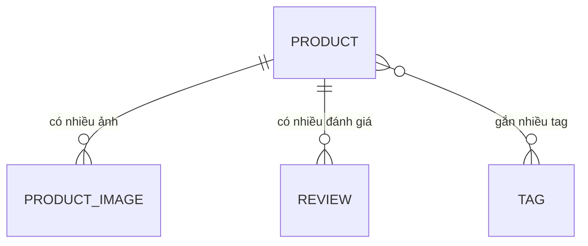

# Domain model — React-CRUD-Practice (quản lý sản phẩm)

Mọi thực thể thuộc domain `products` (PROD). Ràng buộc ghi theo code hiện có (brownfield); nguồn là
đường dẫn file.

## Overview

## Product — domain products

Một mặt hàng trong danh mục, là đối tượng chính của danh sách, tìm kiếm, sắp xếp và lọc theo khoảng giá.

| Attribute | Meaning | Required | Constraints |
| --- | --- | --- | --- |
| id | Định danh, tự tăng | yes | duy nhất — backend/src/products/product.entity.ts |
| title | Tên sản phẩm | yes | 3–100 ký tự — backend/src/products/dto/create-product.dto.ts |
| description | Mô tả | yes khi tạo | không rỗng khi tạo; DB cho phép rỗng — create-product.dto.ts, product.entity.ts |
| category | Danh mục | yes khi tạo | không rỗng khi tạo — create-product.dto.ts |
| brand | Thương hiệu | no | — |
| price | Giá bán hiện tại | yes | `numeric(10,2)`, tối đa 2 chữ số thập phân (docs/requirements/price-range.md#Yêu cầu; product.entity.ts); backend nhận ≥ 0 (create-product.dto.ts), form frontend đòi > 0 (frontend/src/utils/productForm.ts) |
| discountPercentage | Phần trăm giảm giá | no | 0–100, mặc định 0 — create-product.dto.ts, product.entity.ts |
| rating | Điểm trung bình | no | `numeric(3,2)`, mặc định 0; không nhận qua API tạo/sửa — product.entity.ts |
| stock | Tồn kho | yes | số nguyên ≥ 0 — create-product.dto.ts |
| minimumOrderQuantity | Số lượng đặt tối thiểu | no | số nguyên ≥ 1, mặc định 1 — create-product.dto.ts |
| availabilityStatus | Trạng thái hàng (chuỗi tự do) | no | — |
| sku | Mã hàng | no | duy nhất; trùng → 409 `sku already exists` — product.entity.ts, products.service.ts |
| barcode | Mã vạch 13 chữ số | yes (tự sinh) | duy nhất, hệ thống sinh — products.service.ts |
| weight, dimensions (width, height, depth) | Khối lượng, kích thước | no | ≥ 0 — create-product.dto.ts |
| warrantyInformation, shippingInformation, returnPolicy | Thông tin bảo hành, giao hàng, đổi trả | no | — |
| thumbnail | Ảnh đại diện | no | không gửi → ảnh đầu tiên trong `images` — products.service.ts |
| reviewCount | Số đánh giá | — (tính toán) | đếm từ `reviews` — product.entity.ts |
| createdAt, updatedAt | Thời điểm tạo / sửa | yes (tự động) | — product.entity.ts |

- **Relationships:** Product có nhiều ProductImage và nhiều Review; Product ↔ Tag nhiều-nhiều qua `product_tags`.
- **Lifecycle:** see `capabilities/products/states.md`
- **Owned by:** không có chủ sở hữu (app không có người dùng / đăng nhập).

## ProductImage — domain products

Một URL ảnh của sản phẩm, giữ thứ tự hiển thị.

| Attribute | Meaning | Required | Constraints |
| --- | --- | --- | --- |
| url | Đường dẫn ảnh (thường từ `POST /uploads`) | yes | — backend/src/products/product-image.entity.ts |
| position | Thứ tự ảnh | yes | mặc định 0 — product-image.entity.ts |

- **Relationships:** thuộc đúng một Product; xoá Product thì xoá ảnh (cascade).
- **Lifecycle:** không có vòng đời riêng; khi sửa `images` của sản phẩm, toàn bộ danh sách ảnh cũ bị thay — products.service.ts
- **Owned by:** Product

## Review — domain products

Một đánh giá có điểm của người mua cho sản phẩm. API hiện không tạo/sửa đánh giá; dữ liệu đến từ seed.

| Attribute | Meaning | Required | Constraints |
| --- | --- | --- | --- |
| rating | Điểm | yes | số nguyên — backend/src/products/review.entity.ts |
| comment | Nội dung | no | — |
| date | Thời điểm đánh giá | yes | — |
| reviewerName, reviewerEmail | Người đánh giá | yes | — |

- **Relationships:** thuộc đúng một Product; xoá Product thì xoá đánh giá (cascade).
- **Lifecycle:** không có vòng đời riêng.
- **Owned by:** Product

## Tag — domain products

Nhãn gắn cho sản phẩm, mỗi tên lưu một lần và dùng chung.

| Attribute | Meaning | Required | Constraints |
| --- | --- | --- | --- |
| name | Tên tag | yes | duy nhất — backend/src/products/tag.entity.ts; tạo khi gặp tên mới — products.service.ts |

- **Relationships:** nhiều-nhiều với Product qua `product_tags`; xoá Product chỉ xoá liên kết, bản ghi Tag giữ nguyên.
- **Lifecycle:** không có vòng đời riêng.
- **Owned by:** dùng chung

## Open questions

- _(không có)_ — ô lọc khoảng giá nhận giá 0 (người dùng trả lời, 2026-11-12). Mâu thuẫn `price ≥ 0` (backend,
  create-product.dto.ts) / `> 0` (form tạo sản phẩm, frontend/src/utils/productForm.ts) là hiện trạng đã biết,
  nằm ngoài phạm vi (xem `traceability.md`).
