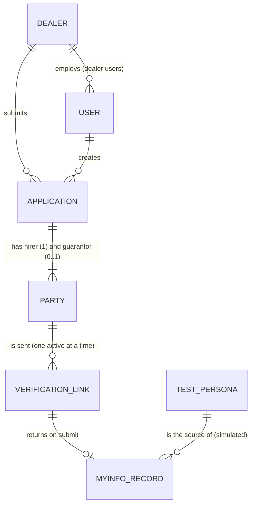

# Domain model — ValueMax Dealer Portal (Singpass Myinfo demo)

"Brief" = `docs/requirements/singpass-demo-brief.md`; "design" = `docs/claude-code-demo/design/`.

## Overview

## Features — domain access

| Feature | Scope |
| --- | --- |
| sign-in | Signing in as the sample dealer user or the sample Ops user (simple login or role switch), and who the backend treats as the current user |

## Features — domain applications

| Feature | Scope |
| --- | --- |
| quick-apply | Dealer screens 1–3: Application Details (hirer, optional guarantor, LTA Access Code, NRIC/FIN, email and mobile validation), Review & Submit with the two confirmations and "Send Singpass Request", Interest Received with Application Ref, link expiry per party and a QR fallback of the link |
| application-tracking | Dealer screen 9: Application Status tracker and the realtime Singpass status of each party for the dealer's own applications |
| ops-review | Ops screens 10–11: All Applications list across dealers with per-party Singpass columns, Application Details with Singpass Status block, "NRIC matched" mark, dealer-entered vs Myinfo comparison, "Cannot issue AA yet" box, Issue IPA and the server-side AA lock, all in realtime |

## Features — domain singpass-verification

| Feature | Scope |
| --- | --- |
| verification-links | Creating one active 72-hour link per party, sending it by email (SMTP or Mailpit, link printed to the log), Resend (new link, old one superseded), expiry, and the customer's link check screen 5 ("This link is no longer valid" vs "Retrieve Myinfo with Singpass") |
| myinfo-consent | Customer screens 6–8 on the simulated Singpass (test persona login, consent with "Cancel" / "I Agree", review tabs, "Submit Application", "Details shared"), the mock gateway (`GetToken`, `GetLinkId`, `person/autofin/{LinkId}`) behind an adapter, NRIC comparison and the resulting party status, encrypted storage of the Myinfo data |

## Features — domain demo

| Feature | Scope |
| --- | --- |
| demo-control | Hidden Demo Control page (e.g. `/demo`): reset the data, create sample applications, force a link into the expired state |

## Dealer — domain access

The car dealer company whose users submit applications (sample: Demo Motors Pte Ltd).

| Attribute | Meaning | Required | Constraints |
| --- | --- | --- | --- |
| name | Company name shown in the portal header and on applications | yes | — |

- **Relationships:** a Dealer has many Users (dealer users) and many Applications.
- **Lifecycle:** none (sample data).
- **Owned by:** seeded sample data (brief §6).

## User — domain access

A person who signs in to the portal: a dealer user or an Ops user.

| Attribute | Meaning | Required | Constraints |
| --- | --- | --- | --- |
| name | Display name (e.g. Alex Tan, Priya Nair) | yes | — |
| role | `dealer` or `ops` | yes | one of the two roles |
| dealer | Dealer the user works for | for `dealer` role | none for `ops` |

- **Relationships:** a dealer User belongs to one Dealer and creates many Applications.
- **Lifecycle:** none (one sample account per role, brief §6).
- **Owned by:** seeded sample data.

## Application — domain applications

A hire-purchase application keyed in by a dealer user through Quick Apply.

| Attribute | Meaning | Required | Constraints |
| --- | --- | --- | --- |
| applicationRef | Reference shown to dealer, Ops and customer | yes | unique; `VMAF-<YYYY>-<NNNNN>`, next = highest + 1, first `05121` (D-26) |
| dealer | Dealer that submitted it | yes | — |
| createdBy | Dealer user who submitted it | yes | — |
| createdAt | Submission time ("Submitted", "Created") | yes | — |
| ltaAccessCode | Code entered on Quick Apply | yes | trimmed, non-empty, no format check (D-27) |
| stage | Current application stage (tracker) | yes | see `capabilities/applications/states.md` |
| ipaIssuedAt | When the IPA was issued | no | set once |
| aaIssuedAt | When the AA was issued | no | set only when every party is Fulfilled |

- **Relationships:** an Application has exactly one hirer Party and zero or one guarantor Party.
- **Lifecycle:** see `capabilities/applications/states.md`.
- **Owned by:** the dealer that submitted it; Ops see every application.

## Party — domain applications

The hirer or the guarantor of an application, as entered by the dealer.

| Attribute | Meaning | Required | Constraints |
| --- | --- | --- | --- |
| role | `hirer` or `guarantor` | yes | one hirer per application, at most one guarantor |
| name | Name as entered by the dealer | yes | — |
| nric | NRIC / FIN as entered by the dealer | yes | valid Singapore NRIC/FIN (S, T, F, G, M) with checksum (D-12); guarantor's differs from hirer's (D-28) |
| email | Email address the Singpass request is sent to | yes | valid email format; may equal the other party's (D-28) |
| phone | Mobile number | yes | 8 digits starting with 8 or 9 (D-13) |
| singpassStatus | Status of the party's latest verification link | yes | `Pending`, `Fulfilled`, `Expired`, `Superseded`, `NRIC mismatch`, `Declined` (derived from the latest link) |

- **Relationships:** a Party belongs to one Application and has many VerificationLinks over time, at most one of them active.
- **Lifecycle:** its Singpass status follows its latest link, see `capabilities/singpass-verification/states.md`.
- **Owned by:** its Application.

## VerificationLink — domain singpass-verification

One verification link sent to a party by email.

| Attribute | Meaning | Required | Constraints |
| --- | --- | --- | --- |
| party | Party the link was sent to | yes | — |
| token | Value in the URL `/v/{token}` | yes | unique |
| triggeredAt | When the link was created and the email sent (Trigger Date) | yes | — |
| expiresAt | Expiry time | yes | `triggeredAt` + 72 hours |
| status | Link status | yes | see `capabilities/singpass-verification/states.md` |
| fulfilledAt | When the link became Fulfilled (Fulfilled Date) | no | — |
| linkId | Gateway LinkId used with `person/autofin/{LinkId}` | no | set when the customer taps "Retrieve Myinfo with Singpass" (D-24) |

- **Relationships:** a VerificationLink belongs to one Party and has at most one MyinfoRecord.
- **Lifecycle:** see `capabilities/singpass-verification/states.md`.
- **Owned by:** its Party.

## MyinfoRecord — domain singpass-verification

The Myinfo data returned by the gateway after the customer consented and submitted.

| Attribute | Meaning | Required | Constraints |
| --- | --- | --- | --- |
| link | Verification link the data came through | yes | — |
| uinfin | NRIC / FIN of the person who logged in | yes | compared with the party's `nric` |
| nricMatched | Whether `uinfin` equals the NRIC the dealer entered | yes | — |
| data | Remaining Myinfo fields (name, date of birth, registered address, employment, CPF contributions, NOA, housing) | only when NRIC matched | stored encrypted (brief §5, D-03); discarded on mismatch (D-22) |
| receivedAt | When the data was received | yes | — |

- **Relationships:** belongs to one VerificationLink; shown in the Ops comparison table.
- **Lifecycle:** none of its own; created once.
- **Owned by:** its VerificationLink.

## TestPersona — domain singpass-verification

A Singpass staging test identity with fake Myinfo data, used by the simulated Singpass login.

| Attribute | Meaning | Required | Constraints |
| --- | --- | --- | --- |
| nric | Test NRIC / FIN | yes | one of `F4440488P`, `F4440489M`, `G4440425M`, `G4440427W`, `G4440430W`, `G4440431T`, `G4440432Q`, `G4440433N`, `M5004553J` |
| myinfoData | Fake Myinfo data following the fields of `singpass-reference/3_…` and `4_…` | yes | `F4440488P` = HENG SHI ZHENG (brief §6) |

- **Relationships:** source of the simulated MyinfoRecords.
- **Lifecycle:** none (fixed sample data).
- **Owned by:** the mock gateway.

## Open questions

_(none: answered in `docs/requirements/decisions.md`)_
