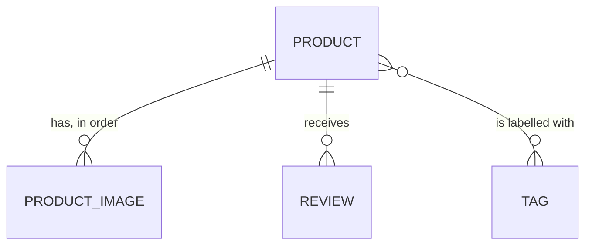

# Domain model — React-CRUD-Practice (product management)

Brownfield: entities and attributes are recorded from the existing code (backend/src/products/*.entity.ts); the
requirement documents add no new entity. One domain: `products` (code `PROD`).

## Overview

## Features — domain products

| Feature | Scope |
| --- | --- |
| filtering | The product list page (`/`, `/products/search`) and `GET /products`: listing, keyword search, sort, pagination and every filter that narrows the list — frontend/src/views/ProductList.tsx, frontend/src/comopnents/ProductListPageCom/ (SearchForm, SearchBar, Sorting, PageNav, ProList, ProductCard, StatusMessage), frontend/src/api/productsQuerParam.ts (`getProducts`), frontend/src/api/queryKeys.ts; backend/src/products/dto/query-product.dto.ts, backend/src/products/products.service.ts (`findAll`, `loadList`) |
| detail | The product detail page (`/products/[id]`) and `GET /products/:id`: one product with its images, tags, reviews, specifications, price and discount, stock — frontend/src/views/ProductDetail.tsx, frontend/src/comopnents/ProductDetail/; backend/src/products/products.service.ts (`findOne`, `loadOne`) |
| management | Creating, editing and deleting products and uploading their images: pages `/products/add`, `/products/[id]/edit`, delete from the list card with a 5-second undo; `POST /products/add`, `PATCH /products/:id`, `DELETE /products/:id`, `POST /uploads` — frontend/src/views/CreateProduct.tsx, EditProduct.tsx, frontend/src/comopnents/ProductFormCom/, ProductListPageCom/CardMenu.tsx, ConfirmDeleteDialog.tsx, frontend/src/hooks/useProductMutations.ts, useProductForm.ts, frontend/src/utils/productForm.ts; backend/src/products/dto/create-product.dto.ts, update-product.dto.ts, backend/src/products/products.service.ts (`create`, `update`, `remove`), backend/src/uploads/uploads.controller.ts |

## Product — domain products

A catalog item a visitor can list, search, view, create, edit and delete.

| Attribute | Meaning | Required | Constraints |
| --- | --- | --- | --- |
| id | Identifier | yes | generated |
| title | Name shown on the card and the detail page | yes | 3–100 characters (create) |
| description | Long text | yes (create) | not empty (create) |
| category | Category name | yes (create) | not empty (create) |
| brand | Brand name | no | not empty when sent |
| price | Current selling price, USD | yes | ≥ 0 on the server, > 0 in the create / edit form (see Open questions); 2 decimals (`numeric(10,2)`) |
| discountPercentage | Discount | no | 0–100, default 0 |
| rating | Average rating | no | 0–9.99 (`numeric(3,2)`), default 0 |
| stock | Quantity left | yes (create) | integer ≥ 0 |
| minimumOrderQuantity | Minimum quantity per order | no | integer ≥ 1, default 1 |
| availabilityStatus | Free-text stock situation | no | — |
| sku | Stock code | no | unique |
| barcode | Generated code | yes | 13 digits, generated on create, unique |
| qrCode | QR code URL | no | — |
| weight, dimensions (width, height, depth) | Physical size | no | ≥ 0 |
| warrantyInformation, shippingInformation, returnPolicy | Free texts | no | not empty when sent |
| thumbnail | Card image | no | first image when not sent |
| reviewCount | Number of reviews | computed | — |
| createdAt, updatedAt | Timestamps | yes | set by the system |

- **Relationships:** a Product has many Product images (ordered) and many Reviews; a Product has many Tags and a Tag
  belongs to many Products.
- **Lifecycle:** see `capabilities/products/states.md`
- **Owned by:** nobody (no login; NFR-011)

## Product image — domain products

One image URL of a product, kept in order.

| Attribute | Meaning | Required | Constraints |
| --- | --- | --- | --- |
| url | Public URL of the image | yes | — |
| position | Order among the product's images | yes | integer, default 0 |

- **Relationships:** belongs to one Product; deleted with it (cascade).
- **Lifecycle:** none of its own; replaced as a whole list when the product's images are edited.
- **Owned by:** its Product

## Review — domain products

A buyer's rated comment on a product. Reviews come from the seed data; the app has no screen to add one.

| Attribute | Meaning | Required | Constraints |
| --- | --- | --- | --- |
| rating | Score | yes | integer |
| comment | Text | no | — |
| date | When it was written | yes | — |
| reviewerName, reviewerEmail | Who wrote it | yes | — |

- **Relationships:** belongs to one Product; deleted with it (cascade).
- **Lifecycle:** none
- **Owned by:** its Product

## Tag — domain products

A label shared between products.

| Attribute | Meaning | Required | Constraints |
| --- | --- | --- | --- |
| name | Label text | yes | unique |

- **Relationships:** belongs to many Products (join table `product_tags`); a tag stays when its products are deleted.
- **Lifecycle:** created on first use when a product is created or edited.
- **Owned by:** nobody

## Open questions

- [NEEDS CLARIFICATION: the server accepts a price `≥ 0` (backend/src/products/dto/create-product.dto.ts) but the
  create / edit form requires `> 0` (frontend/src/utils/productForm.ts, message "Giá phải lớn hơn 0."). Which one is
  the rule? On branch `001-products-price-range` you decided to leave this out of scope; keep that?]
